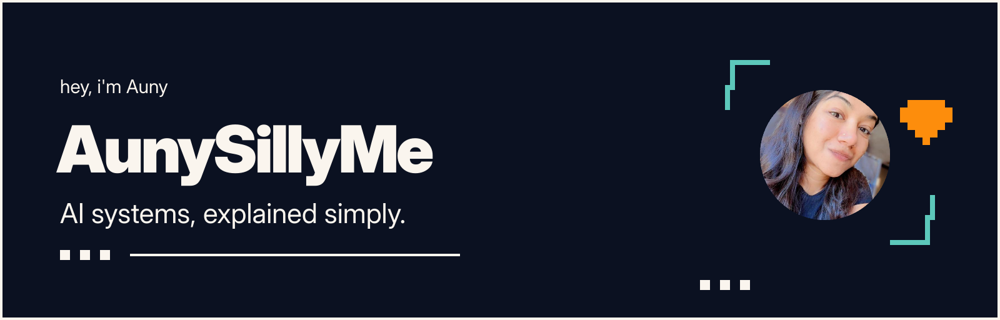
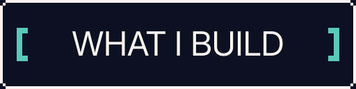
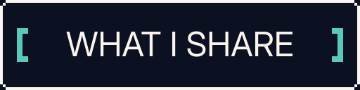
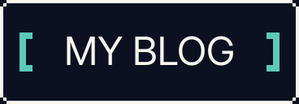
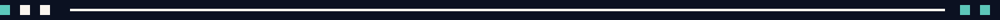
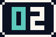

<p align="center">
  
</p>

<p align="center">
  <a href="https://aunysillyme.dev"></a>
  <a href="https://x.com/AunySillyMe"></a>
  <a href="https://aunysillyme.com/blog"></a>
</p>

<p></p>

##  Hey, I'm Auny

I build and break down AI systems in public and teach creators how to use them.

Most of my day goes into building with my Claude and other models, testing tools, and figuring out how to make them useful in my actual work. Then I share what I learned in plain words, so you can use it too.

I run my brand **AunySillyMe**, work in content and consulting, build my own sites, and run ad campaigns for myself and clients. I'm also a brand ambassador for **Adobe Firefly**.

##  Open sourcing my tools

###  [model-orchestrator](https://github.com/aunysillyme/model-orchestrator)

Give your AI coding agent rules for choosing the model and effort for each task, plus subagents, hooks, and a runner for delegated work.

```sh
npx model-orchestrator
```

###  [agent-personalizer](https://github.com/aunysillyme/agent-personalizer)

Keep your profile and instructions in one place, then generate the files each AI reads. A drift check catches copies that stop matching.

```sh
npx agent-personalizer
```

###  [website-build-skill](https://github.com/aunysillyme/website-build-skill)

Teach your AI to research before it builds a website, then work through design, code, accessibility, performance, search, security, and review.

```sh
npx website-build-skill
```

###  [repo-build-skill](https://github.com/aunysillyme/repo-build-skill)

Teach your AI to build, release, and launch a GitHub repo: the stack, README, AGENTS.md, showing up in search and AI answers, and safe publishing to npm.

```sh
npx repo-build-skill
```

[More of my repos](https://github.com/aunysillyme?tab=repositories) · [My npm packages](https://www.npmjs.com/~aunysillyme)

##  What I work with

**Claude Code · Codex · almost all agents and LLMs**

**TypeScript · Python · Cloudflare · Supabase · Obsidian**

My work includes AI workflows, agents, tools that connect them to other apps, and the instructions that keep them working together.

##  There's more to me than code

I make art, write, and release music as **Auny**. I've been an artist all my life. AI is one of the ways I create now.

You can find my content and consulting on [aunysillyme.com](https://aunysillyme.com), my AI work on [aunysillyme.dev](https://aunysillyme.dev), and my music on [auny.media](https://auny.media).

<p></p>

##  Come say hi

I share what I'm building and learning on [X](https://x.com/AunySillyMe) and in [Explained Without Fluff](https://explained-without-fluff.beehiiv.com).

For work, you can reach me at [auny@aunysillyme.com](mailto:auny@aunysillyme.com).
